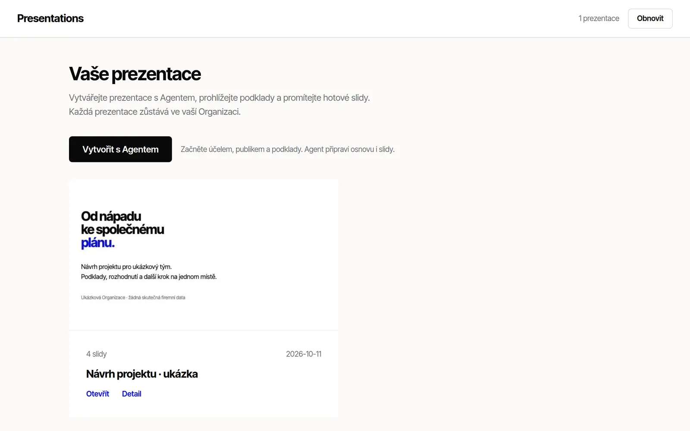

# Presentations

A presentation library for a Lazurio Organization: browse first-slide
previews, read a deck's purpose and sources, present HTML slides with arrow
keys and print them to 16:9 PDF pages. "Vytvořit s Agentem" gives you a brief
to paste into your own Agent's chat; the Agent agrees an outline with you,
drafts the deck from your Organization's sources and prepares a pull request.

It is a free template of the Lazurio Marketplace, released under the
[MIT License](LICENSE); see [NOTICE](NOTICE) for fonts and trademarks.



## What it is and is not

- One Bun server with a React gallery and a read-only API. Decks are files in
  Git, so every change is a reviewable pull request.
- No visual slide editor, AI API integration, PPTX export or automatic
  publication. The app needs no account, API key or paid service; your Agent
  and hosting keep their own costs. No SLA is offered.
- The only bundled presentation is a synthetic four-slide project proposal.
  The library and starter use the Lazurio design system with locally hosted
  Inter Tight Variable and Geist Mono ([design provenance](docs/design-system.md)).
- The app UI is in Czech.

## Use it

Add it to your Organization from the Marketplace in Lazurio, or follow
[docs/adoption.md](docs/adoption.md) with your Agent. Develop it further with
[docs/extending.md](docs/extending.md).

For a local check, in `app/v1`:

```sh
bun install --frozen-lockfile
bun run check
```

Start an adopted module through the Lazurio lifecycle
(`lazurio module start <Organization>/<module>`); without Lazurio's listener
settings the app refuses to start.

## More

[Architecture](ARCHITECTURE.md) · [Marketplace listing](docs/marketplace.md) ·
[Release procedure](docs/release.md) · [Changelog](CHANGELOG.md) ·
[Agent rules](AGENTS.md)

## Support

Report problems and questions as Issues in this repository
(`LazurioExampleOrganization/presentations`). Never attach credentials or your
Organization's presentations to a public issue.
