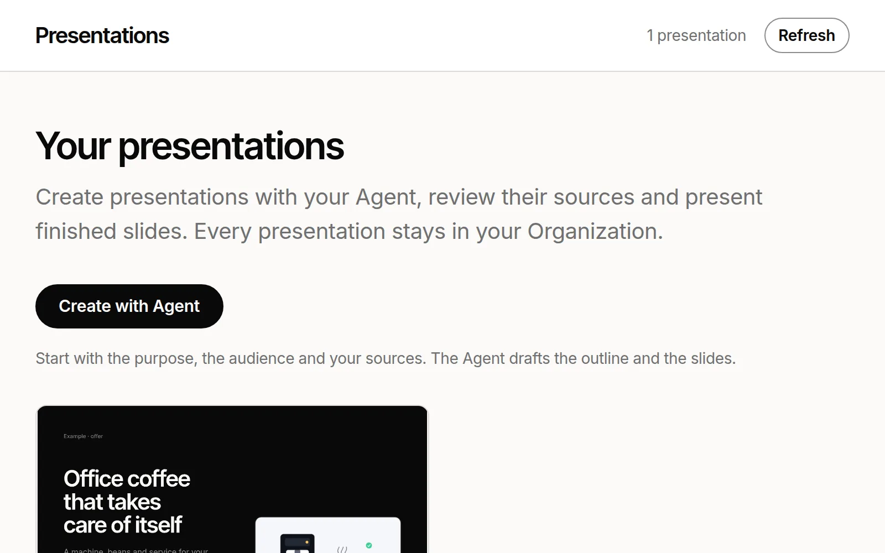

# Presentations

A presentation module for a Lazurio Organization. Your Agent writes a deck
from your sources as a short structured file, one command builds it into
slides, and the library shows every deck with its first-slide preview, its
purpose and its sources. Present in the browser, print to 16:9 PDF pages,
play local videos, and open a personal version for one prospect with their
name on the title slide. Everything works in Czech and in English.

It is a free template of the Lazurio Marketplace, released under the
[MIT License](LICENSE); see [NOTICE](NOTICE) for fonts and trademarks.



## What it does

- **Decks from source.** A deck is `data/v1/decks/<date-slug>/deck.source.json`
  with eleven slide types: title, section, problem, quote, options, case
  study, timeline, metrics with a growth chart, video, appendix and
  closing. `bun run deck:build` validates it and writes the slides
  ([slide types](docs/slide-types.md)).
- **Presenting.** A 1920 × 1080 stage fitted to any screen, arrow keys,
  swipe, full screen, the slide in the address, print to one 16:9 page per
  slide.
- **Video.** Local files only; a video starts muted when its slide opens,
  sound only with its button.
- **Personal version.** `?for=<name>&org=<organization>` on a deck's link
  shows "Prepared for …" on the title and closing slides. Nothing is
  stored; the library's detail builds the link.
- **Czech and English.** The library follows the language of your Lazurio;
  a deck can carry both languages, each with its own page and preview.
- **Your design system.** The library and the decks wear the design system
  package `design-system` (`LazurioTemplates/design-system` v2.0.0, or your
  Organization's own at a released tag): its styles, components, fonts and
  tokens ([design](docs/design-system.md)).
- **Skills for agents** in `.agents/skills/` and `.claude/skills/`:
  prepare a deck from sources (`deck-from-sources`), a personal version for
  a prospect (`deck-personal-version`), add a slide of a given type
  (`deck-add-slide`).

The only bundled deck is a sample offer of the invented company Example,
in Czech and English, using every slide type. No customer data.

## What it is not

No visual slide editor, no AI API of its own, no PPTX export and no
automatic publication. The App needs no account, API key or paid service;
your Agent and hosting keep their own costs. No SLA is offered.

## Use it

Add it to your Organization from the Marketplace in Lazurio, or follow
[docs/adoption.md](docs/adoption.md) with your Agent. Develop it further
with [docs/extending.md](docs/extending.md).

For a local check, in `app/v1`:

```sh
bun install --frozen-lockfile
bun run check
```

Start an adopted module through the Lazurio lifecycle
(`lazurio module start <Organization>/<module>`); without Lazurio's listener
settings the App refuses to start.

## More

[Slide types](docs/slide-types.md) · [Architecture](ARCHITECTURE.md) ·
[Design](docs/design-system.md) · [Marketplace listing](docs/marketplace.md) ·
[Release procedure](docs/release.md) · [Changelog](CHANGELOG.md) ·
[Agent rules](AGENTS.md)

## Support

Report problems and questions as Issues in this repository
(`LazurioTemplates/presentations`). Never attach credentials or your
Organization's presentations to a public issue.

## This Organization's copy

This is the Presentations module of
[Lazurio Example Organization](https://github.com/LazurioExampleOrganization),
adopted from the Lazurio Marketplace template
[`LazurioTemplates/presentations`](https://github.com/LazurioTemplates/presentations)
at release `v0.1.0` (commit `4b023772fbe45c2209b6eb1ff44009239ed1ac99`) by
merging it into this repository, so later releases arrive as ordinary merges
([docs/extending.md](docs/extending.md)); the current release is `v0.2.0`
(commit `2629dce5a7c3108bc88c2d1f3ec4f539356ac63f`). The library is in
English (`language: "en"` in `app/v1/src/instance.ts`) and starts with the
template's sample deck of the invented company Example, in its English
variant and preview. Its design system is still the template's package
`github:LazurioTemplates/design-system#v2.0.0`; it moves to the
Organization's own `github:LazurioExampleOrganization/design-system#v2.0.0`
once that tag is released.
